  

  

## Connect with me 🏁

<!-- Replace the links below with your own, or delete the ones you don't use. -->

  
  
  
  

## About me 🏎️

- 🧑‍💻 Full-stack developer from the Philippines
- 🏫 Building systems for **BISCAST**: alumni tracking and examination assessment
- 📄 Working on **Paper Trail**, a document tracking system for institutions
- 🌐 Web apps with **ASP.NET MVC**, **Laravel** and **React**
- 📱 Mobile apps with **Flutter**
- 🎮 Built **Unity** games back in college
- 📫 Reach me at **your.email@example.com**

 

## Tech stack 🔧

**Languages**

  
  
  
  
  
  
  
  
  

**Frameworks & libraries**

  
  
  
  
  

**Tools**

  
  
  

## Featured projects 🚀

| Project | What it does | Language / Stack | Status |
|---|---|---|---|
| [**Paper Trail**](https://github.com/edevEsperida/paper-trail) | Web-based document tracking system that lets institutions follow the real-time status and movement of documents through internal workflows | JavaScript | 🟡 Work in progress |
| [**Portfolio**](https://github.com/edevEsperida/portfolio) | Personal portfolio showcasing projects, skills and experience, with a responsive UI | TypeScript · React | ✅ Live |
| [**Park-In**](https://github.com/edevEsperida/Park-In) | Parking app for mobile | Dart · Flutter | ✅ Completed |

  
  
  

<b>🎓 College & practice projects</b>

 

| Project | What it is | Language |
|---|---|---|
| [**TicTacToe**](https://github.com/edevEsperida/TicTacToe) | Browser-based Tic-Tac-Toe game | JavaScript |
| [**HoneyLight**](https://github.com/edevEsperida/HoneyLight) | Static website project | HTML · CSS |
| [**uplift**](https://github.com/edevEsperida/uplift) | Web design project | CSS · HTML |

## Stats 📊

  
  

  

  

  

